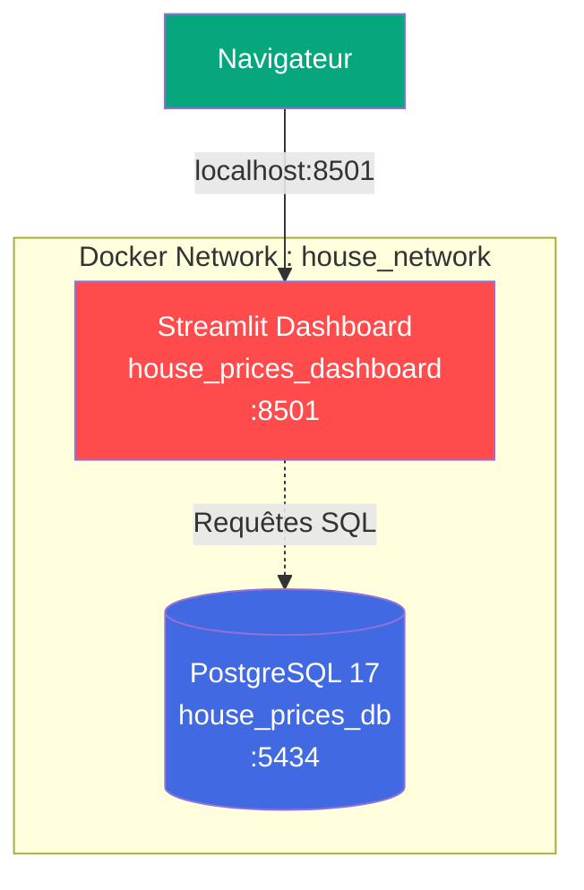

## 🚀 Installation & lancement

### 🐳 Option 1 — Avec Docker (recommandé)

**Prérequis** : [Docker Desktop](https://www.docker.com/products/docker-desktop)

```bash
# 1. Cloner le repo
git clone https://github.com/abderrahmanamaoulouden533-ops/sales-dashboard-bi.git
cd sales-dashboard-bi

# 2. Lancer la stack complète (DB + Dashboard)
docker compose up -d

# 3. Charger les données dans la DB Docker
# (modifier .env temporairement avec DB_PORT=5434)
python src/load_sql.py

# 4. Accéder au dashboard
# → http://localhost:8501
```

**Commandes utiles** :

```bash
docker compose ps              # État des containers
docker compose logs -f         # Logs en direct
docker compose down            # Arrêter
docker compose down -v         # Arrêter + supprimer les données
```

---

### 🐍 Option 2 — Installation locale

**Prérequis** : Python 3.11+, PostgreSQL 14+

#### 1️⃣ Cloner le repository

```bash
git clone https://github.com/abderrahmanamaoulouden533-ops/sales-dashboard-bi.git
cd sales-dashboard-bi
```

#### 2️⃣ Créer un environnement virtuel

```bash
python -m venv .venv

# Windows
.venv\Scripts\activate

# Linux / macOS
source .venv/bin/activate
```

#### 3️⃣ Installer les dépendances

```bash
pip install -r requirements.txt
```

#### 4️⃣ Configurer PostgreSQL

```bash
psql -U postgres -c "CREATE DATABASE house_prices;"
```

Copie `.env.example` en `.env` et renseigne tes identifiants :

```env
DB_HOST=localhost
DB_PORT=5432
DB_NAME=house_prices
DB_USER=postgres
DB_PASSWORD=your_password_here
```

#### 5️⃣ Charger les données

```bash
# Télécharger le dataset Kaggle
python src/download_data.py

# Nettoyer + créer les features
python src/clean.py

# Créer le schéma SQL
psql -U postgres -d house_prices -f sql/schema.sql

# Charger dans PostgreSQL
python src/load_sql.py

# Entraîner les modèles ML
python src/train_model.py
```

#### 6️⃣ Lancer le dashboard

```bash
streamlit run app/dashboard.py
```

→ [http://localhost:8501](http://localhost:8501) 🎉

---

## 🧪 Tests

Le projet est couvert par **21 tests unitaires** (pytest).

```bash
# Lancer tous les tests
pytest

# Avec rapport de couverture
pytest --cov=src --cov-report=term-missing
```

**Résultat attendu** :

```
21 passed in 1.55s

---------- coverage -----------
src/clean.py        93%
src/predict.py      89%
...
```

---

## 🤖 Modèles de Machine Learning

4 modèles de régression ont été entraînés et comparés pour prédire le prix de vente :

| Modèle | R² | RMSE | MAE |
|:-------|:--:|:----:|:---:|
| **🏆 XGBoost** | **0.9128** | **$25 857** | **$16 046** |
| Gradient Boosting | 0.9075 | $26 639 | $16 249 |
| Ridge | 0.9024 | $27 364 | $16 955 |
| Random Forest | 0.8781 | $30 583 | $17 329 |

**Interprétation** : Le meilleur modèle (XGBoost) explique **91 % de la variance** des prix avec une erreur moyenne absolue de **~$16 000** (soit ~9 % du prix moyen).

### Features utilisées

- **23 features numériques** : `OverallQual`, `GrLivArea`, `TotalSF`, `GarageArea`, `YearBuilt`, `HouseAge`...
- **8 features catégorielles** : `Neighborhood`, `MSZoning`, `HouseStyle`, `CentralAir`...

---

## 🏗️ Architecture Docker



---

## 📊 Application — 3 pages interactives

| Page | Description |
|:-----|:------------|
| 📊 **Dashboard BI** | Analyse exploratoire avec filtres (quartier, qualité, année, prix) et 7 visualisations |
| 🤖 **Prédiction** | Formulaire interactif pour estimer le prix d'une maison via XGBoost |
| 📈 **Performance ML** | Comparaison des 4 modèles avec métriques (R², RMSE, MAE) |

---

## 🔮 Améliorations futures

- [ ] ☁️ **Déploiement cloud** — Streamlit Cloud + Supabase (PostgreSQL hébergé)
- [ ] 🎯 **Hyperparameter tuning** — GridSearchCV / Optuna pour XGBoost
- [ ] 📊 **Feature importance** — Visualiser l'importance des features du modèle
- [ ] 🆚 **Mode comparaison** — Comparer 2 quartiers côte à côte
- [ ] 🌍 **Multilingue** — Interface FR / EN
- [ ] 📓 **SHAP values** — Interprétabilité du modèle

---

## 🤝 Contribution

Les contributions sont les bienvenues !

1. Fork le projet
2. Crée une branche (`git checkout -b feature/AmazingFeature`)
3. Commit (`git commit -m 'feat: add AmazingFeature'`)
4. Push (`git push origin feature/AmazingFeature`)
5. Ouvre une **Pull Request**

---

## 👤 Auteur

<div align="center">

**Abderrahman Amaoulouden**

*Data Analyst / Data Engineer*

[](https://github.com/abderrahmanamaoulouden533-ops)

</div>

---

## 📄 Licence

Ce projet est sous licence **MIT**. Voir [LICENSE](LICENSE).

> ⚠️ **Note** : Le dataset [*House Prices*](https://www.kaggle.com/c/house-prices-advanced-regression-techniques) est distribué par Kaggle sous conditions d'usage **académique et non-commercial**.

---

<div align="center">

### ⭐ Si ce projet t'a plu, n'hésite pas à lui donner une étoile !

*Fait avec ❤️ par [Abderrahman Amaoulouden](https://github.com/abderrahmanamaoulouden533-ops)*

</div>