<div align="center">

# 🏠 House Prices — Dashboard BI & Analyse Immobilière

**Analyse interactive du marché immobilier d'Ames, Iowa (USA) · 1 460 transactions**

[](https://www.python.org/)
[](https://streamlit.io/)
[](https://www.postgresql.org/)
[](https://pandas.pydata.org/)
[](https://plotly.com/)

[](LICENSE)
[](https://peps.python.org/pep-0008/)
[](https://github.com/abderrahmanamaoulouden533-ops/sales-dashboard-bi/pulls)

Un projet **end-to-end de Data Engineering & Business Intelligence** : du dataset brut à un dashboard interactif, en passant par le nettoyage, la modélisation SQL et le storytelling visuel.

[🔍 Explorer le projet](#-objectifs-du-projet) · [🚀 Installation](#-installation--lancement) · [📊 Insights](#-insights-clés) · [👤 Auteur](#-auteur)

</div>

---

## 📑 Table des matières

- [🎯 Objectifs du projet](#-objectifs-du-projet)
- [📊 Insights clés](#-insights-clés)
- [🛠️ Stack technique](#️-stack-technique)
- [🏗️ Architecture du pipeline](#️-architecture-du-pipeline)
- [📁 Structure du projet](#-structure-du-projet)
- [🚀 Installation & lancement](#-installation--lancement)
- [📈 Fonctionnalités du dashboard](#-fonctionnalités-du-dashboard)
- [🧪 Qualité & tests](#-qualité--tests)
- [🔮 Améliorations futures](#-améliorations-futures)
- [👤 Auteur](#-auteur)
- [📄 Licence](#-licence)

---

## 🎯 Objectifs du projet

Ce projet illustre un **workflow Data complet**, du dataset brut à la restitution métier :

| # | Étape | Description |
|---|-------|-------------|
| 1️⃣ | **Nettoyage** | Traitement de **7 829 valeurs manquantes** sur un dataset de 81 colonnes avec Pandas/NumPy |
| 2️⃣ | **Feature Engineering** | Création de 8 features dérivées (âge, surface totale, ratio prix/sqft, indicateurs binaires...) |
| 3️⃣ | **Modélisation SQL** | Schéma en étoile (`neighborhoods` + `houses`) dans PostgreSQL avec index optimisés |
| 4️⃣ | **KPIs métier** | Calcul de 5 KPIs d'analyse immobilière via requêtes SQL agrégées |
| 5️⃣ | **Visualisation** | Dashboard interactif Streamlit avec 7 graphiques Plotly |
| 6️⃣ | **Storytelling** | Mise en évidence des facteurs clés influençant le prix d'une maison |

---

## 📊 Insights clés

> 💡 **Résultats de l'analyse sur 1 460 transactions immobilières**

| Indicateur | Valeur |
|:-----------|:-------|
| 💰 **Prix moyen** | **180 921 $** (médiane : 163 000 $) |
| 📐 **Prix au sqft** | **70 $ / sqft** en moyenne |
| 🏘️ **Écart entre quartiers** | De **145 847 $** (NAmes) à **335 295 $** (NoRidge) → **×2,3** |
| ⭐ **Impact de la qualité** | Une maison notée **10** se vend **8,8× plus cher** qu'une notée **2** |
| 🔥 **Cheminée** | **+25 %** de prix moyen avec cheminée |
| 🚗 **Garage** | **+22 %** de prix moyen avec garage |
| 📅 **Évolution temporelle** | Les maisons des **années 2000+** valent **2,8× plus** que celles des **années 1900** |

**Conclusion métier** : La **qualité globale** (`OverallQual`) et la **localisation** (`Neighborhood`) sont les deux facteurs les plus discriminants du prix. Ces deux variables expliquent à elles seules plus de 70 % de la variance observée.

---

## 🛠️ Stack technique

<div align="center">

| Catégorie | Technologies |
|:---------:|:-------------|
| **Langage** |  |
| **Data** |   |
| **Base de données** |   |
| **Dashboard** |  |
| **Visualisation** |  |
| **Config** |  |

</div>

---

## 🏗️ Architecture du pipeline

```mermaid
flowchart LR
    A[📥 Dataset Kaggle<br/>train.csv<br/>1460 × 81] --> B[🧹 Nettoyage<br/>Pandas/NumPy]
    B --> C[⚙️ Feature Engineering<br/>+8 features]
    C --> D[💾 CSV propre<br/>1460 × 89]
    D --> E[(🗄️ PostgreSQL<br/>houses + neighborhoods)]
    E --> F[📊 Requêtes SQL<br/>KPIs + agrégats]
    F --> G[🎨 Dashboard Streamlit<br/>Plotly]
    
    style A fill:#FFB4A2,stroke:#333,stroke-width:2px
    style B fill:#A8DADC,stroke:#333,stroke-width:2px
    style C fill:#A8DADC,stroke:#333,stroke-width:2px
    style D fill:#457B9D,stroke:#333,stroke-width:2px,color:#fff
    style E fill:#1D3557,stroke:#333,stroke-width:2px,color:#fff
    style F fill:#457B9D,stroke:#333,stroke-width:2px,color:#fff
    style G fill:#06A77D,stroke:#333,stroke-width:2px,color:#fff
```



---

## 📁 Structure du projet

```
sales-dashboard-bi/
│
├── 📂 data/
│   ├── raw/                          # Dataset brut (train.csv + description)
│   └── processed/                    # Dataset nettoyé (houses_clean.csv)
│
├── 📂 notebooks/
│   └── 01_eda.ipynb                  # Analyse exploratoire (EDA)
│
├── 📂 src/
│   ├── __init__.py
│   ├── download_data.py              # Téléchargement Kaggle (kagglehub)
│   ├── clean.py                      # Nettoyage + features dérivées
│   ├── load_sql.py                   # Chargement PostgreSQL
│   └── kpis.py                       # Fonctions de calcul des KPIs
│
├── 📂 sql/
│   └── schema.sql                    # Schéma en étoile + index
│
├── 📂 app/
│   └── dashboard.py                  # Dashboard Streamlit
│
├── 📄 .env.example                   # Template variables d'environnement
├── 📄 .gitignore
├── 📄 requirements.txt
├── 📄 LICENSE
├── 📄 README.md
└── 📄 test_db.py                     # Script de test de connexion DB
```

---

## 🚀 Installation & lancement

### 📋 Prérequis

- **Python 3.11+**
- **PostgreSQL 14+**
- **Git**

### 1️⃣ Cloner le repository

```bash
git clone https://github.com/abderrahmanamaoulouden533-ops/sales-dashboard-bi.git
cd sales-dashboard-bi
```

### 2️⃣ Créer un environnement virtuel

```bash
python -m venv .venv

# Windows
.venv\Scripts\activate

# Linux / macOS
source .venv/bin/activate
```

### 3️⃣ Installer les dépendances

```bash
pip install -r requirements.txt
```

### 4️⃣ Configurer PostgreSQL

Crée la base de données :

```bash
psql -U postgres -c "CREATE DATABASE house_prices;"
```

Copie le fichier d'exemple et renseigne tes identifiants :

```bash
cp .env.example .env      # Linux/macOS
copy .env.example .env    # Windows
```

Édite `.env` :

```env
DB_HOST=localhost
DB_PORT=5432
DB_NAME=house_prices
DB_USER=postgres
DB_PASSWORD=your_password_here
```

### 5️⃣ Charger les données

```bash
# Étape 1 — Télécharger le dataset depuis Kaggle
python src/download_data.py

# Étape 2 — Nettoyer + créer les features
python src/clean.py

# Étape 3 — Créer le schéma SQL
psql -U postgres -d house_prices -f sql/schema.sql

# Étape 4 — Charger les données dans PostgreSQL
python src/load_sql.py
```

**Résultat attendu** :

```
📊 Dataset chargé : 1460 lignes, 81 colonnes
🔍 Valeurs manquantes avant : 7829
✅ Valeurs manquantes après : 0
✅ 25 quartiers insérés
✅ 1460 maisons insérées
```

### 6️⃣ Lancer le dashboard

```bash
streamlit run app/dashboard.py
```

Le dashboard s'ouvre sur **[http://localhost:8501](http://localhost:8501)** 🎉

---

## 📈 Fonctionnalités du dashboard

### 🎛️ Filtres interactifs

- **Quartier** (multiselect sur 25 quartiers)
- **Note de qualité** (slider 1 → 10)
- **Année de construction** (slider 1870 → 2010)
- **Prix maximum** (slider 30 000 $ → 800 000 $)

### 📊 KPIs dynamiques

| KPI | Description |
|-----|-------------|
| 🏠 **Nombre de maisons** | Total filtré |
| 💰 **Prix moyen** | Moyenne des prix de vente |
| 📐 **Prix / sqft** | Ratio prix au pied carré |
| 📏 **Surface moyenne** | Surface habitable moyenne |
| 📅 **Âge moyen** | Âge moyen des biens |

### 📉 7 visualisations Plotly

1. **Prix moyen par quartier** — Bar chart horizontal (Top 15)
2. **Distribution des prix** — Histogramme 40 bins
3. **Prix vs Surface habitable** — Scatter coloré par qualité
4. **Prix moyen par note de qualité** — Bar chart avec dégradé
5. **Évolution du prix par décennie** — Line chart temporel
6. **Impact du garage** — Donut chart
7. **Impact de la cheminée et de la piscine** — Donut charts

---

## 🧪 Qualité & tests

| Critère | Résultat |
|---------|----------|
| **Valeurs manquantes** | ✅ 0 après nettoyage (7 829 traitées) |
| **Traçabilité pipeline** | ✅ Reproductible : `raw → clean → SQL → dashboard` |
| **Modélisation** | ✅ Schéma en étoile (dimension + fait) |
| **Index SQL** | ✅ 3 index (neighborhood, saleprice, yearbuilt) |
| **Performance** | ✅ Cache Streamlit (`@st.cache_data`, TTL 10 min) |
| **Sécurité** | ✅ Secrets dans `.env`, non commité |
| **Code style** | ✅ PEP8 |

### 🧪 Test de connexion rapide

```bash
python test_db.py
```

Sortie attendue :

```
✅ Connexion PostgreSQL OK
   Version : PostgreSQL 17.x ...
   Tables trouvées : 2
     - houses
     - neighborhoods
```

---

## 🔮 Améliorations futures

- [ ] 🤖 **Modèle de prédiction** — Régression linéaire ou XGBoost pour estimer le prix
- [ ] 📓 **Notebook EDA** — Analyse exploratoire documentée (`notebooks/01_eda.ipynb`)
- [ ] 🧪 **Tests unitaires** — `pytest` pour valider le nettoyage et les requêtes
- [ ] ☁️ **Déploiement cloud** — Streamlit Cloud + Supabase (PostgreSQL hébergé)
- [ ] 🆚 **Mode comparaison** — Comparer 2 quartiers côte à côte
- [ ] 🌍 **Multilingue** — Interface FR / EN
- [ ] 🐳 **Dockerisation** — `Dockerfile` + `docker-compose.yml`

---

## 🤝 Contribution

Les contributions sont les bienvenues ! Pour contribuer :

1. Fork le projet
2. Crée une branche (`git checkout -b feature/AmazingFeature`)
3. Commit tes changements (`git commit -m 'feat: add AmazingFeature'`)
4. Push (`git push origin feature/AmazingFeature`)
5. Ouvre une **Pull Request**

---

## 👤 Auteur

<div align="center">

**Abderrahman Amaoulouden**

*Data Analyst / Data Engineer*

[](https://github.com/abderrahmanamaoulouden533-ops)

</div>

---

## 📄 Licence

Ce projet est distribué sous licence **MIT**. Voir le fichier [LICENSE](LICENSE) pour plus de détails.

> ⚠️ **Note sur les données** : Le dataset [*House Prices - Advanced Regression Techniques*](https://www.kaggle.com/c/house-prices-advanced-regression-techniques) est distribué par Kaggle et soumis à ses propres conditions d'utilisation (**usage académique et non-commercial uniquement**).

---

<div align="center">

### ⭐ Si ce projet t'a plu, n'hésite pas à lui donner une étoile !

*Fait avec ❤️ et beaucoup de ☕ par [Abderrahman Amaoulouden](https://github.com/abderrahmanamaoulouden533-ops)*

</div>
